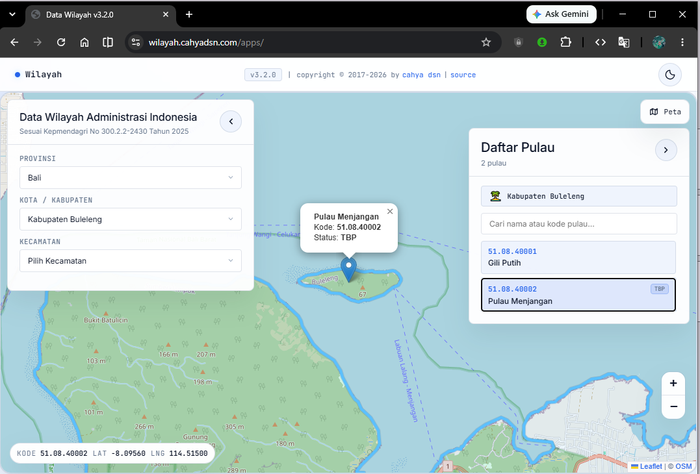
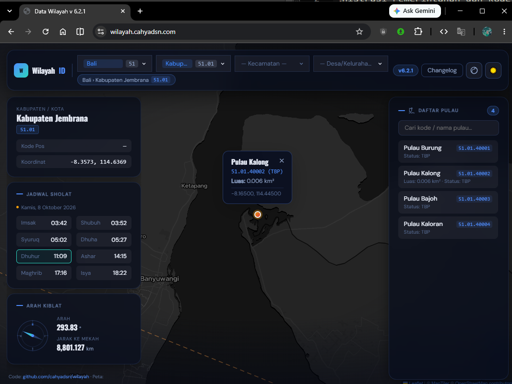

# WILAYAH
Kode dan Data Wilayah Administrasi Pemerintahan dan Kode Pulau Indonesia sesuai Kepmendagri No 300.2.2-2430 Tahun 2025 menggunakan PHP+MySQL+AJaX

[](LICENSE)
[](https://github.com/cahyadsn/wilayah/issues)
[](https://github.com/cahyadsn/wilayah/network)
[](https://github.com/cahyadsn/wilayah/stargazers)

[](https://github.com/cahyadsn/wilayah)
[](https://paypal.me/cahyadwiana)

## DEMO
tautan demo web [apps versi 3.2.0](https://wilayah.cahyadsn.com/apps)

## SCREENSHOT
[](https://wilayah.cahyadsn.com/apps)

Kode dan Data Wilayah Pemerintahan Indonesia dalam database :
- **db/wilayah.sql** sesuai dengan Kepmendagri No. 300.2.2-2430 Tahun 2025 
- **db/wilayah_level_1_2.sql** sesuai Kepmendagri No. 300.2.2-2430 Tahun 2025 untuk data provinsi dan kab/kota dengan koordinat,elevation,timezone,luas, jumlah penduduk dan boundaries
- **db/archive/wilayah_2023.sql** sesuai Kepmendagri No. 100.1.1-6117 Tahun 2022
- **db/archive/wilayah_2022.sql** sesuai Permendagri No. 58 Tahun 2021 (_revised by Kepmendagri No. 050-145 Tahun 2022_)
- **db/archive/wilayah_2020.sql** sesuai Permendagri No. 72 Tahun 2019 (_revised by Kepmendagri No.146.1-4717 Tahun 2020_)
- **db/archive/wilayah_2018.sql** sesuai Permendagri No. 137 tahun 2017
- **db/archive/wilayah_2016.sql** sesuai Permendagri No. 56 Tahun 2015
- **db/archive/wilayah_level_1_2-2022.sql** sesuai Kepmendagri No. 100.1.1-6117 Tahun 2022 untuk data provinsi dan kab/kota dengan koordinat,elevation,timezone,luas, jumlah penduduk dan boundaries (mysql)
- **db/archive/wilayah_level_1_2_postgresql.sql** sesuai Kepmendagri No. 100.1.1-6117 Tahun 2022 untuk data provinsi dan kab/kota dengan koordinat,elevation,timezone,luas, jumlah penduduk dan boundaries (postgresql)

Kode dan Data Pulau Indonesia dalam database :
- **db/wilayah_pulau.sql** sesuai Kepmendagri No. 300.2.2-2430 Tahun 2025 untuk data pulau Indonesia dilengkapi dengan koordinat (lat, lng), status pulau (BP/TBP), luas, dan catatan
- **db/archive/pulau_2025.sql** sesuai Kepmendagri No 300.2.2-2138 Tahun 2025
- **db/archive/pulau_2023.sql** sesuai Kepmendagri No 100.1.1-6117 Tahun 2022
- **db/archive/pulau_2022.sql** sesuai Permendagri No 58 Tahun 2021 (revised by Kepmendagri No. 050-145 Tahun 2022)

Data Jumlah Penduduk Indonesia per propinsi dan per kabupaten/kota dalam database
- **db/wilayah_penduduk.sql** sesuai Kepmendagri No 300.2.2-2430 Tahun 2025 *

Data Luas wilayah Indonesia per provinsi dan per kabupaten/kota dalam database
- **db/wilayah_luas.sql** sesuai dengan Kepmendagri No 300.2.2-2430 Tahun 2025 dan Badan Informasi Geospasial berdasarkan Surat Deputi Bidang Informasi Geospasial Dasar Nomor B-16.10/DIGD-BIG/IGD.04.04/12/2024, Tanggal 16 Desember 2024, Hal Penghitungan Luas Wilayah di Seluruh Indonesia

## TAUTAN TERKAIT
- Data kodepos vs kode wilayah administrasi pemerintahan Indonesia : https://github.com/cahyadsn/wilayah_kodepos
- Data referensi Kode dan Data Wilayah Administrasi Pemerintahan dan Pulau Indonesia : https://github.com/cahyadsn/wilayah_ref
- Data boundaries/polygon berdasarkan kode wilayah administrasi pemerintahan Indonesia : https://github.com/cahyadsn/wilayah_boundaries
- Data logo/lambang berdasarkan kode wilayah administrasi pemerintahan Indonesia (prov,kab/kota) : https://github.com/cahyadsn/wilayah_logo
- Implementasi API data kode wilayah administrasi pemerintahan Indonesia : https://github.com/cahyadsn/wilayah_api

## Data Kepmendagri No 300.2.2-2430 Tahun 2025
Database Data dan Kode Wilayah Administrasi Pemerintahan sesuai Kepmendagri No 300.2.2-2430 Tahun 2025 (wilayah.sql)

| id_prov | nama                       | kab   | kota  | kec  | kel   | desa  |    luas     | penduduk  | pulau  |
|---------|----------------------------|------:|------:|------|------:|------:|------------:|----------:|-------:|
| 11      | Aceh*                      |   18  |    5  | 290  |    0  | 6500  |   56835.019 |   5623479 |   369* |
| 12      | Sumatera Utara*            |   25  |    8  | 455  |  693  | 5417  |   72437.755 |  15640905 |   224* |
| 13      | Sumatera Barat             |   12  |    7  | 179  |  230  | 1035  |   42107.674 |   5820359 |   219  |
| 14      | Riau                       |   10  |    2  | 172  |  271  | 1591  |   89900.780 |   7099297 |   144  |
| 15      | Jambi                      |    9  |    2  | 144  |  171  | 1414  |   49023.037 |   3834439 |    14  |
| 16      | Sumatera Selatan           |   13  |    4  | 241  |  403  | 2856  |   86771.918 |   9064690 |    24  |
| 17      | Bengkulu                   |    9  |    1  | 129  |  172  | 1341  |   20122.210 |   2127957 |     9  |
| 18      | Lampung                    |   13  |    2  | 229  |  205  | 2446  |   33570.758 |   9144263 |   172  |
| 19      | Kepulauan Bangka Belitung  |    6  |    1  |  47  |   84  |  309  |   16670.225 |   1549562 |   501  |
| 21      | Kepulauan Riau             |    5  |    2  |  80  |  144  |  275  |    8170.375 |   2271890 |  2028  |
| 31      | DKI Jakarta                |    1  |    5  |  44  |  267  |    0  |     661.530 |  11038216 |   113  |
| 32      | Jawa Barat                 |   18  |    9  | 627  |  646  | 5311  |   37053.331 |  51316378 |    30  |
| 33      | Jawa Tengah                |   29  |    6  | 576  |  753  | 7810  |   34347.428 |  38430645 |    71  |
| 34      | DI Yogyakarta              |    4  |    1  |  78  |   46  |  392  |    3170.363 |   3743365 |    37  |
| 35      | Jawa Timur                 |   29  |    9  | 666  |  773  | 7721  |   48055.876 |  41919906 |   538  |
| 36      | Banten                     |    4  |    4  | 155  |  314  | 1238  |    9355.763 |  12881374 |    80  |
| 51      | Bali                       |    8  |    1  |  57  |   80  |  636  |    5582.827 |   4375263 |    41  |
| 52      | Nusa Tenggara Barat        |    8  |    2  | 117  |  145  | 1021  |   19631.991 |   5751295 |   430  |
| 53      | Nusa Tenggara Timur        |   21  |    1  | 315  |  305  | 3137  |   46378.105 |   5700772 |   653  |
| 61      | Kalimantan Barat           |   12  |    2  | 174  |   99  | 2046  |  147018.063 |   5646268 |   260  |
| 62      | Kalimantan Tengah          |   13  |    1  | 136  |  139  | 1432  |  153430.363 |   2825290 |    71  |
| 63      | Kalimantan Selatan         |   11  |    2  | 156  |  144  | 1872  |   37125.426 |   4305281 |   165  |
| 64      | Kalimantan Timur           |    7  |    3  | 105  |  197  |  841  |  126951.758 |   4123303 |   244  |
| 65      | Kalimantan Utara           |    4  |    1  |  55  |   35  |  447  |   69900.886 |    770627 |   196  |
| 71      | Sulawesi Utara             |   11  |    4  | 171  |  332  | 1507  |   14488.429 |   2645291 |   382  |
| 72      | Sulawesi Tengah            |   12  |    1  | 177  |  175  | 1842  |   61496.983 |   3219494 |  1600  |
| 73      | Sulawesi Selatan           |   21  |    3  | 313  |  793  | 2266  |   45323.975 |   9528276 |   394  |
| 74      | Sulawesi Tenggara          |   15  |    2  | 221  |  377  | 1908  |   36139.303 |   2824589 |   591  |
| 75      | Gorontalo                  |    5  |    1  |  77  |   72  |  657  |   12024.982 |   1250960 |   127  |
| 76      | Sulawesi Barat             |    6  |    0  |  69  |   73  |  575  |   16590.667 |   1466741 |    69  |
| 81      | Maluku*                    |    9  |    2  | 119  |   35  | 1200  |   46133.832 |   1935586 |  1422  |
| 82      | Maluku Utara               |    8  |    2  | 118  |  118  | 1067  |   31465.977 |   1394231 |   975  |
| 91      | Papua*                     |    8  |    1  | 105  |   51  |  948  |   81383.315 |   1102360 |   544  |
| 92      | Papua Barat                |    7  |    0  |  91  |   21  |  803  |   60308.590 |    576255 |  1498  |
| 93      | Papua Selatan              |    4  |    0  |  82  |   13  |  677  |  117858.969 |    562220 |     7  |
| 94      | Papua Tengah               |    8  |    0  | 131  |   36  | 1172  |   61079.587 |   1369112 |    50  |
| 95      | Papua Pegunungan           |    8  |    0  | 252  |   10  | 2617  |   52508.656 |   1470518 |     0  |
| 96+     | Papua Barat Daya           |    5  |    1  | 132  |   74  |  939  |   39103.058 |    623186 |  3082  |
|         | TOTAL                      |  416  |   98  |7285  | 8496  |75266  | 1890179.784 | 284973643 | 17380  |

**NOTE** :

)* data mengalami perubahan dari data sebelumnya (data Kepmendagri No. 300.2.2-2138 Tahun 2025)

- Nama Provinsi diurutkan sesuai dengan Kode Wilayah Administrasi Pemerintahan
- Luas wilayah (dalam km persegi) bersumber dari Badan Informasi Geospasial berdasarkan Surat Deputi Bidang Informasi Geospasial Dasar Nomor B-16.10/DIGD-BIG/IGD.04.04/12/2024, Tanggal 16 Desember 2024, Hal Penghitungan Luas Wilayah di Seluruh Indonesia
- Jumlah penduduk bersumber dari Ditjen Kependudukan dan Pencatatan Sipil Kemendagri (Data Kependudukan Semester II Bulan Desember Tahun 2024)
- Jumlah pulau termasuk 6 pulau besar ( Sumatera, Jawa, Kalimantan, Sulawesi, Timor, dan Papua) 
- Sumber data pulau Gazeter Republik Indonesia (GRI) Tahun 2024 yang diterbitkan oleh Badan Informasi Geospasial (BIG)

> link demo bisa dilihat di sini : https://wilayah.cahyadsn.com/
[](https://wilayah.cahyadsn.com/)

## KODEFIKASI DATA WILAYAH
Kode Wilayah Administrasi Pemerintahan adalah serangkaian angka dan titik yang menunjukkan Kode dan Data Wilayah Administrasi Pemerintahan Indonesia pada setiap daerah/wilayah mulai dari tingkat desa/kelurahan, kecamatan, kota/kabupaten, hingga provinsi yang digunakan untuk mempermudah dan mempercepat pengelolaan wilayah administrasi pemerintahan Republik Indonesia.

Berdasarkan Permendagri No 58 Tahun 2021 kodefikasi data wilayah administrasi pemerintahan dan pulau adalah sesuai aturan susunan sebagai berikut:

## FUNGSI DAN TUJUAN KODE WILAYAH
-  **Identifikasi administratif**: Memudahkan pengelolaan data dan informasi pemerintahan.
-  **Standarisasi nasional**: Digunakan dalam dokumen resmi, statistik, dan sistem informasi pemerintah.
-  **Referensi geografis**: Menunjukkan lokasi dan hierarki wilayah secara sistematis.

### KODE WILAYAH
**Kode Provinsi**
Kode untuk daerah provinsi terdiri dari 2 (dua) digit yaitu:
1. Digit pertama Kode untuk daerah provinsi didasarkan pada letak geografis Pulau/kepulauan Indonesia yang dimulai dari arah barat ke timur; dan
2. Digit kedua diisi sesuai dengan urutan pembentukan provinsi.

**Kode Kabupaten/Kota**
Kode untuk daerah kabupaten/kota terdiri dari 4 (empat) digit, yaitu:
1. Kode untuk daerah provinsi berjumlah 2 (dua) digit;
2. Kode untuk daerah kabupaten/kota berjumlah 2 (dua) digit yang ditulis secara berurutan;
3. Digit ketiga dan keempat dari 4 (empat) digit Kode untuk kabupaten diisi dengan angka 01 (nol  satu)  sampai  dengan  69  (enam  puluh sembilan); dan
4. Digit ketiga dan keempat dari 4 (empat) digit Kode untuk kota diisi dengan angka 71 (tujuh puluh satu) sampai dengan 99 (sembilan puluh sembilan).

**Kode Kecamatan**
Kode  untuk  Kecamatan  berjumlah  6  (enam)  digit yang terdiri dari Kode untuk daerah provinsi 2 (dua) digit, Kode untuk daerah kabupaten/kota berjumlah 2 (dua) digit, dan Kode untuk Kecamatan berjumlah 2 (dua) digit yang ditulis secara berurutan.

**Kode Desa/Kelurahan**
Kode untuk Kelurahan dan Desa berjumlah 10 (sepuluh) digit, terdiri dari Kode untuk daerah provinsi berjumlah 2 (dua) digit, Kode untuk daerah kabupaten/kota berjumlah 2 (dua) digit, Kode untuk Kecamatan berjumlah 2 (dua) digit, dan Kode untuk Kelurahan dan Desa berjumlah 4 (empat) digit yang ditulis secara berurutan, sebagai berikut:
1. urutan pertama dari 4 (empat) digit Kode untuk Kelurahan menggunakan angka 1 (satu); dan
2. urutan pertama dari 4 (empat) digit Kode untuk Desa menggunakan angka 2 (dua).
3. urutan pertama dari 4 (empat) digit Kode untuk Desa adat menggunakan angka 3 (tiga).

### KODE PULAU
Kode Pulau berjumlah 9 (sembilan) digit terdiri dari:
1. Kode untuk daerah provinsi berjumlah 2 (dua) digit,
2. Kode untuk daerah kabupaten/kota berjumlah 2 (dua) digit; dan
3. Kode  Pulau  berjumlah  5  (lima)  digit  dengan urutan pertama menggunakan angka 4 (empat).

## REFERENSI
- Dokumen Referensi : https://github.com/cahyadsn/wilayah_ref
- Keputusan Menteri Dalam Negeri Nomor 300.2.2-2430 tahun 2025 Tentang Perubahan Atas Keputusan Menteri Dalam Negeri Nomor 300.2.2-2138 Таhun 2025 Tentang Pemberian Dan Pemutakhiran Kode, Data Wilayah Administrasi Pemerintahan, Dan Pulau (Ditetapkan pada 23 Juni 2025)
- Keputusan Menteri Dalam Negeri Nomor 300.2.2-2138 tahun 2025 Tentang Pemberian Dan Pemutakhiran Kode, Data Wilayah Administrasi Pemerintahan, Dan Pulau (Ditetapkan pada 25 April 2025)
- Keputusan Menteri Dalam Negeri Nomor 100.1.1-6117 Tahun 2022 Tentang Pemberian dan Pemutakhiran Kode, Data Wilayah Adminstrasi Pemerintahan, dan Pulau (Ditetapkan pada 9 November 2022)
- UU No 29 Tahun 2022 tentang Pembentukan Provinsi Papua Barat Daya (_LN.2022/No.223, TLN No.6831, jdih.setneg.go.id: 15 hlm., 08 Desember 2022_)
- UU No 14 Tahun 2022 tentang Pembentukan Provinsi Papua Selatan (LN.2022/No.157, TLN No.6803, jdih.setneg.go.id: 15 hlm., 25 Juli 2022)
- UU No 15 Tahun 2022 tentang Pembentukan Provinsi Papua Tengah (LN.2022/No.158, TLN No.6804, jdih.setneg.go.id: 14 hlm., 25 Juli 2022)
- UU No 16 Tahun 2022 tentang Pembentukan Provinsi Papua Pegunungan (LN.2022/No.159, TLN No.6805, jdih.setneg.go.id: 14 hlm., 25 Juli 2022)
- Keputusan Menteri Dalam Negeri Nomor 050-145 Tahun 2022 Tentang Pemberian Kode, Data Wilayah Administrasi Pemerintahan, Dan Pulau Tahun 2021 (Kepmendagri No. 050-145 Tahun 2022, https://www.kemendagri.go.id/arsip/detail/10857/keputusan-menteri-dalam-negeri-nomor-050145-tahun-2022-tentang-pemberian-kode-data-wilayah-administrasi-pemerintahan-dan-pulau-tahun-2021 (Ditetapkan pada tanggal 14 Februari 2022)
- Peraturan Menteri Dalam Negeri Republik Indonesia Nomor 58 Tahun 2021 Tentang Kode, Data Wilayah Administrasi Pemerintahan, Dan Pulau https://paralegal.id/peraturan/peraturan-menteri-dalam-negeri-nomor-58-tahun-2021/ (Permendagri No.58 2021, Ditetapkan pada tanggal 13 Desember 2021,Berita Negara Tahun 2021 Nomor 1391)
- Penetapan Nama, Kode Dan Jumlah Desa Seluruh Indonesia Tahun 2020 (Kepmendagri No. 146.1-4717 - 2020) http://binapemdes.kemendagri.go.id/produkhukum/detil/keputusan-menteri-dalam-negeri-nomor-1461-4717-tahun-2020 (Ditetapkan pada tanggal 21 Desember 2020)
- Kode dan Data Wilayah Administrasi Pemerintahan (Permendagri No.72-2019) https://www.kemendagri.go.id/page/read/48/peraturan-menteri-dalam-negeri-no72-tahun-2019 (Berita Negara Republik Indonesia Tahun 2019 Nomor 1327, Ditetapkan pada tanggal 8 Oktober 2019)
- Kode dan Data Wilayah Administrasi Pemerintahan (Permendagri No.137-2017) http://www.kemendagri.go.id/produk-hukum/2018/01/18/kode-dan-data-wilayah-administrasi-pemerintahan-tahun-2017 (Berita Negara Republik Indonesia Tahun 2017 Nomor 1955, Ditetapkan pada tanggal 27 Desember 2017)
- Kode dan Data Wilayah Administrasi Pemerintahan (Permendagri No.56-2015) www.kemendagri.go.id/pages/data-wilayah (Berita Negara Republik Indonesia Tahun 2015 Nomor 1045, Ditetapkan pada tanggal 29 Juni 2015)
## PENGUJIAN DATABASE

Untuk memeriksa validitas sintaksis file SQL di dalam direktori `db/` serta mendeteksi duplikasi nilai `'kode'`, Anda dapat menjalankan skrip pemeriksa (syntax checker) berbasis Node.js yang terdapat pada folder `tools/`:

```bash
# Memeriksa data wilayah utama
node tools/check_sql_wilayah.js

# Memeriksa data wilayah tingkat 1 & 2 (Provinsi, Kab/Kota) beserta batas wilayah (polygon)
node tools/check_sql_wilayah_level_1_2.js

# Memeriksa data luas wilayah
node tools/check_sql_wilayah_luas.js

# Memeriksa data penduduk wilayah
node tools/check_sql_wilayah_penduduk.js

# Memeriksa data pulau
node tools/check_sql_wilayah_pulau.js
```

## TO DO
- [ ] **Perbandingan Wilayah Multidimensi**: Fitur komparasi *head-to-head* dua wilayah (provinsi atau kab/kota) mencakup matriks statistik demografi, rasio visual perbandingan, dan batas poligon ganda pada peta.
- [ ] **Linimasa Histori Pemekaran Wilayah**: Visualisasi kronologis evolusi administratif Indonesia (*time-travel* 2016–2025) berbasis arsip data resmi untuk menelusuri dinamika pembentukan daerah otonomi baru (DOB) dan status pulau.
- [ ] **Analisis Radius & Pengukuran Spasial Maritim**: Alat ukur geodesik jarak antar-titik/pulau (km dan Nautical Miles) serta analisis lingkaran radius (*buffer zone*) untuk mendeteksi pulau-pulau dalam jangkauan.
- [ ] **Deteksi GPS "Wilayah di Sekitar Saya"**: Integrasi HTML5 Geolocation dan algoritma *Ray-Casting* untuk mengidentifikasi hierarki wilayah administrasi resmi (Provinsi hingga Desa/Kelurahan) serta pulau terdekat dari posisi pengguna secara instan.
- [ ] **Developer Playground & Generator Widget Dropdown**: Konsol interaktif pengujian API wilayah, generator cuplikan kode integrasi multi-bahasa (JS, PHP, Python, Dart, cURL), dan *scaffolder* formulir dropdown bertingkat mandiri (*zero-dependency*).

## CHANGE LOG
- [2026-11-19] 🆕
  - **Fitur Cluster Marker Seluruh Pulau (Island Marker Clustering - P5)**:
    - **Visualisasi Spasial Masif & Integrasi Leaflet.markercluster (`apps/index.php`, `apps/inc/geo_js.php`)**:
      - Integrasi pustaka `Leaflet.markercluster` versi 1.5.3 dengan konfigurasi performa tinggi: `chunkedLoading: true`, `chunkInterval: 100`, `chunkDelay: 50`, `maxClusterRadius: 50`, `spiderfyOnMaxZoom: true`, `showCoverageOnHover: false`, dan `zoomToBoundsOnClick: true` untuk merender ribuan pulau tanpa lag browser.
      - Penambahan kontrol sakelar toggle UI *"Sebarkan di peta"* (`#toggleShowAllIslands` & `#islandClusterToggleWrapper`) pada panel daftar pulau (`#islandPanel`) dengan penyimpanan preferensi di `localStorage` (`wilayahShowAllIslands`).
      - Pengelolaan layer dinamis (`populateIslandClusters`, `clearIslandClusters`) dengan siklus hidup bersih saat berpindah provinsi / kabupaten / kota.
      - Sinkronisasi dua arah instan: mengklik marker cluster di peta menyorot (*is-active*) dan menggulir otomatis (*smooth scroll*) item terkait di sidebar kanan; mengklik item pulau di sidebar kanan memicu `islandClusterGroup.zoomToShowLayer` untuk membuka cluster dan menampilkan popup secara langsung.
      - Desain template popup pulau seragam (`.island-popup`) dengan informasi kode, status, luas daratan, koordinat, dan sanitasi ketat anti-XSS via `escapeHtml()`.
    - **Penataan Gaya Adaptif & Minifikasi (`apps/css/styles.css`, `apps/css/styles.min.css`)**:
      - Styling kustom marker cluster (`.marker-cluster`, `.marker-cluster-small`, `.marker-cluster-medium`, `.marker-cluster-large`) dengan palet warna elegan adaptif mode terang dan mode gelap (*theme-aware CSS variables*).
      - Sakelar toggle switch bergaya iOS/Material (`.switch`, `.slider.round`) yang serasi dengan layout header panel pulau.
    - **Pengujian Unit & Kualitas Kode**:
      - Memperluas test suite Jest [`tests/apps/inc/geo_js.test.js`](tests/apps/inc/geo_js.test.js) (52 pengujian Jest lulus 100%) mencakup siklus hidup cluster, XSS sanitization pada popup, integrasi localStorage, auto-populate, dan fallback marker tunggal.
      - Seluruh test suite PHPUnit (137 pengujian, 726 asersi) tetap lulus 100%.
- [2026-11-13] 
  - **Fitur Unduh Poligon & Data Spasial (Spatial Data Export - P4)**:
    - **Backend Generator & Export Engine (`apps/inc/geo_export.php`)**:
      - Endpoint ekspor geospasial dan tabular on-the-fly yang mendukung format **GeoJSON** (RFC 7946), **KML 2.2** (Google Earth / GIS), dan **CSV** (Comma-Separated Values dengan UTF-8 BOM).
      - Target ekspor fleksibel: batas wilayah (`target=boundary`), daftar pulau (`target=islands`), dan statistik demografi wilayah (`target=stats`).
      - Validasi parameter ketat (`kode`, `format`, `target`) dengan proteksi sanitasi regex dan penanganan kode nasional `all`/`0`.
      - Konversi koordinat standar RFC 7946 (`[lat, lng]` database ke `[lng, lat]` GeoJSON) dengan penutupan otomatis linear ring dan dukungan `Polygon` maupun `MultiPolygon`.
      - Streaming output memori efisien menggunakan `php://output` dan `fputcsv()`.
      - Keamanan header unduhan: sanitasi nama berkas anti-CRLF/path-traversal via `preg_replace('/[^a-zA-Z0-9_\-]/', '_', ...)`, `Content-Disposition`, dan `X-Content-Type-Options: nosniff`.
    - **Antarmuka Pengguna & Integrasi Peta (`apps/index.php`, `apps/inc/geo_js.php`, `apps/css/styles.css`, `apps/css/styles.min.css`)**:
      - Menambahkan tombol menu dropdown ekspor (*Unduh Data*) pada overlay info peta (`#infoStrip`): GeoJSON batas wilayah, KML Google Earth, dan CSV statistik demografi.
      - Menambahkan tombol unduh CSV pulau (`#btnExportIslands`) pada bagian atas panel daftar pulau (`#islandPanel`).
      - Integrasi status wilayah aktif (`getActiveRegionCode` & `#n_kode`) dan integrasi notifikasi toast saat proses unduhan dimulai.
      - Desain responsif dengan tema adaptif (dark & light mode) dan event listener dropdown ramah aksesibilitas (*click outside & escape key*).
    - **Pengujian Unit & Kualitas Kode**:
      - Menambahkan test suite PHPUnit [`tests/apps/inc/GeoExportTest.php`](tests/apps/inc/GeoExportTest.php) (8 pengujian, 84 asersi) mencakup validasi input, GeoJSON RFC 7946, KML Placemarks, MultiPolygon, ekspor nasional, pulau CSV, dan stats CSV dengan kelulusan 100% (total 137 pengujian PHPUnit lulus).
      - Memperluas test suite Jest [`tests/apps/inc/geo_js.test.js`](tests/apps/inc/geo_js.test.js) (total 37 pengujian Jest lulus 100%) untuk fungsi `getExportUrl`, resolusi kode aktif, dan inisialisasi kontrol ekspor.
- [2026-11-12] 
  - **Fitur Choropleth Map & Peta Tematik Demografi (Choropleth Map - P3)**:
    - **Backend Agregasi Data Geospasial & Demografi (`apps/inc/geo_thematic.php`)**:
      - Menambahkan endpoint GeoJSON FeatureCollection untuk agregasi data poligon batas wilayah tingkat nasional (seluruh 38 provinsi) maupun tingkat provinsi (seluruh kabupaten/kota di bawahnya).
      - Menghitung metrik turunan secara dinamis: Kepadatan Penduduk (`kepadatan` = jiwa/km²) dan Rasio Jenis Kelamin (`sex_ratio` = pria / 100 wanita) dengan proteksi pembagian nol (`luas <= 0`).
      - Konverter koordinat standar RFC 7946 (`[lat, lng]` basis data ke `[lng, lat]` GeoJSON) untuk tipe geometry `Polygon` dan `MultiPolygon`.
      - Sistem *server-side caching* berbasis JSON di `apps/cache/thematic_{prov}_{metric}.json` dengan masa berlaku (TTL) 7 hari dan HTTP Cache Headers.
    - **Visualisasi Peta Tematik & Kontrol Interaktif (`apps/inc/geo_js.php`, `apps/css/styles.css`, `apps/css/styles.min.css`)**:
      - Menambahkan kontrol pemilih mode tematik Leaflet di pojok kanan atas peta (*Standar | Kepadatan Penduduk | Rasio Gender*).
      - Menerapkan palet warna ColorBrewer 5-kelas untuk kepadatan penduduk (skala kuning ke merah pekat) dan rasio gender (diverging biru-kuning-merah) yang adaptif terhadap tema terang/gelap (*dark/light mode*).
      - Menambahkan kartu legenda dinamis di pojok kiri bawah peta (`L.control({ position: 'bottomleft' })`) dengan indikator warna dan rentang nilai yang diperbarui otomatis.
      - Interaksi hover interaktif: penyorotan batas poligon wilayah (`weight: 3.5`, `color: '#38bdf8'`), pengembalian gaya saat mouseout, dan kartu tooltip mengambang dengan informasi detail statistik wilayah.
      - Interaksi klik poligon tematik yang tersinkronisasi langsung dengan dropdown hierarki wilayah dan panel pulau.
      - Sinkronisasi parameter URL peramban (`&thematic=density` atau `&thematic=sex_ratio`).
    - **Pengujian Unit & Kualitas Kode**:
      - Menambahkan test suite PHPUnit [`tests/apps/inc/GeoThematicTest.php`](tests/apps/inc/GeoThematicTest.php) (5 pengujian, 279 asersi) dengan kelulusan 100% (total 129 pengujian PHPUnit lulus).
      - Memperluas test suite Jest [`tests/apps/inc/geo_js.test.js`](tests/apps/inc/geo_js.test.js) (total 28 pengujian Jest lulus 100%) untuk pengujian gradasi warna tematik, styling fitur GeoJSON, dan parsing parameter URL tematik.
- [2026-11-11] 
  - **Fitur Tautan Berbagi & Deep Linking (Shareable URL & Deep Linking - P2)**:
    - **Sinkronisasi Status URL Dua Arah (`apps/inc/geo_js.php`, `apps/js/wilayah.js`)**:
      - Sinkronisasi instan parameter URL peramban (`kode`, `pulau`, `theme`, `zoom`, `lat`, `lng`) menggunakan `history.replaceState` dan `history.pushState` tanpa me-reload halaman.
      - Integrasi otomatis saat pengguna memilih wilayah hierarki, memilih pulau dari panel samping, mencari via autocomplete, menggeser tema (dark/light), atau menavigasi klik peta.
    - **Cold-Start Hydration & Riwayat Navigasi Browser**:
      - Modul `hydrateFromUrl()` secara otomatis merekonstruksi rantai hierarki wilayah (`buildChainFromKode` & `applyReverseSelection`), membuka dropdown terkait, menggambar batas poligon wilayah, menempatkan marker, dan memfokuskan kamera peta.
      - Dukungan penuh tombol *Back* & *Forward* peramban pengguna melalui event listener `popstate`.
    - **Antarmuka Pengguna Berbagi & Notifikasi Toast (`apps/index.php`, `apps/css/styles.css`, `apps/css/styles.min.css`)**:
      - Menambahkan tombol "Bagikan" (`#btnShareLink`) pada navigasi utama dan tombol salin koordinat (`#btnCopyLocation`) pada overlay info geospasial peta.
      - Integrasi Web Share API (`navigator.share`) untuk perangkat seluler modern dengan fallback otomatis ke Clipboard API (`navigator.clipboard.writeText`) dan textarea fallback.
      - Komponen toast notifikasi ringan (`#toastNotification`) dengan animasi halus tanpa dependensi pustaka luar.
    - **Keamanan & Validasi Parameter (XSS Prevention)**:
      - Sanitasi regex ketat pada level server PHP (`apps/index.php`) dan klien JavaScript (`getUrlParams`) untuk mencegah injeksi skrip atau parameter ilegal.
    - **Pengujian Unit & Kualitas Kode**:
      - Menambahkan test suite PHPUnit [`tests/apps/IndexDeepLinkTest.php`](tests/apps/IndexDeepLinkTest.php) (3 pengujian, 15 asersi) dengan 100% kelulusan (total 124 pengujian PHPUnit lulus).
      - Memperluas test suite Jest [`tests/apps/inc/geo_js.test.js`](tests/apps/inc/geo_js.test.js) (total 20 pengujian Jest lulus 100%) untuk validasi sanitasi query parameter, rekonstruksi rantai kode wilayah, dan notifikasi toast.
- [2026-11-10] 
  - **Fitur Pencarian Global Instan (Global Search Autocomplete - P1)**:
    - **Backend Search Engine (`apps/inc/geo_search.php`)**:
      - Menambahkan endpoint pencarian cepat untuk seluruh tingkatan wilayah administrasi (Provinsi, Kab/Kota, Kecamatan, Desa/Kelurahan) dan pulau Indonesia.
      - Mengoptimalkan kueri basis data dengan pencarian prefix berbasis indeks B-Tree (`wilayah_name_idx` & `pulau_nama_idx`) serta fallback pencarian substring dengan waktu respon < 50ms.
      - Resolusi hierarki satu langkah (*batch query*) untuk menghasilkan nama induk (*parent*) serta struktur rantai seleksi (*chain*).
      - Sanitasi input ketat (regex whitelist, 2–50 karakter) dan caching respon server-side 24 jam berbasis SHA-256 (`apps/cache/search_cache_*`).
    - **Antarmuka Pengguna & Interaktivitas Peta (`apps/index.php`, `apps/inc/geo_js.php`, `apps/css/styles.css`, `apps/css/styles.min.css`)**:
      - Menambahkan input pencarian cepat pada panel selector dengan debounce 250ms, tombol clear, loading spinner, dan dropdown kartu hasil (*flyout card*).
      - Menambahkan badge kategori warna dinamis untuk setiap tingkatan wilayah dan pulau dengan dukungan penuh tema terang dan gelap (*dark/light mode*).
      - Navigasi keyboard aksesibel (`ArrowUp`, `ArrowDown`, `Enter`, `Escape`).
      - Integrasi otomatis dengan dropdown hierarki (`applyReverseSelection`), pergerakan kamera peta Leaflet (`map.flyTo`), penggambaran batas poligon, serta penempatan marker pulau (`onSelectIsland`).
    - **Peningkatan Pengujian Unit**:
      - Menambahkan test suite PHPUnit [`tests/apps/inc/GeoSearchTest.php`](tests/apps/inc/GeoSearchTest.php) (8 pengujian: validasi karakter, kueri nama wilayah, kueri kode, kueri pulau, batasan limit, penanganan eror) dengan 100% kelulusan (total 121 pengujian PHPUnit).
      - Memperluas test suite Jest [`tests/apps/inc/geo_js.test.js`](tests/apps/inc/geo_js.test.js) untuk pengujian rendering elemen hasil pencarian, interaksi seleksi, dan penutupan flyout (total 9 pengujian Jest 100% lulus).
    - **Metadata Berkas**:
      - Memperbarui timestamp `last edit` pada seluruh berkas yang dimodifikasi.
- [2026-11-10] RELEASE v2026.11

> Riwayat perubahan selengkapnya dapat dilihat pada [change_log.md](change_log.md).

## INFORMASI
- data kode wilayah pemerintahan diperoleh dari https://drive.google.com/file/d/1o_m621D00TtwCwQMLn8XUnV3nolamPDm/view?usp=sharing
- data polygon diperoleh dari website BIG(Badan Informasi Geospatial) di https://tanahair.indonesia.go.id
- data latitude/longitude dari google maps

## DONASI
- untuk donasi via transfer
    - Bank BCA Digital (Blu) (501) 000 576 776 186
    - Bank Jago (542) 5003 5796 1022
    - Bank Sinarmas (153) 005 462 4719
    - Bank Syariah Indonesia (BSI) 821-342-5550
- untuk donasi via PayPal [https://paypal.me/cahyadwiana]
- untuk donasi via QRIS CAHYADSN ID1022183125288 :


[di sini]: https://wilayah.cahyadsn.com/
